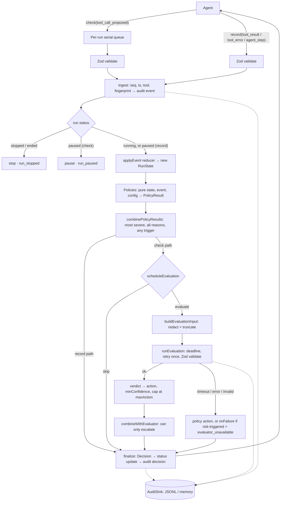

# JevGuard architecture

## Data flow

`record()` takes the same path up to the combined policy result but never calls the evaluator. `check()` goes through a per-run promise queue, so concurrent checks are processed one at a time and each one sees the result of the one before.

## Module map

| Path | Responsibility |
|---|---|
| `src/guard.ts` | `createGuard`, the `Run` implementation, orchestration, audit sanitization |
| `src/schemas/` | Zod schemas: events, decisions, config (with defaults), evaluator output and input |
| `src/state/runState.ts` | `RunState`, `enrichEvent` (envelope and fingerprints), the pure `applyEvent` reducer, `resumeState` |
| `src/state/fingerprint.ts` | Canonical JSON, call, error and result fingerprints |
| `src/state/window.ts` | Sliding-window helpers |
| `src/policies/` | One pure policy per concern, plus the registry `defaultPolicies` |
| `src/decision/combine.ts` | Severity order, merging policy results, evaluator cap and escalation-only merge |
| `src/evaluator/scheduler.ts` | Pure "should Jev be called now?" |
| `src/evaluator/input.ts` | Builds the redacted, truncated `EvaluationInput` |
| `src/evaluator/run.ts` | Deadline, retry and validation (`runEvaluation`); verdict → action (`evaluatorAction`) |
| `src/evaluator/questions.ts` | **All** TypeSafe question text, options, the pinned model and the threshold |
| `src/evaluator/typesafe.ts` | `TypeSafeEvaluator` (official SDK), request builder, response mapping, error mapping |
| `src/evaluator/mock.ts` | Scripted `MockEvaluator` |
| `src/audit/` | `AuditSink` and record types, `JsonlFileSink`, `MemorySink`, redaction and truncation |
| `src/util/` | Injected `Clock`, `IdGenerator`, `SerialQueue` |
| `examples/research-agent/` | Example agent with fake tools; imports only `src/index.ts` |
| `scripts/` | Transcript replay and `eval:calibrate` |

There is no global state. The clock, ID generator, evaluator, audit sink and policy set are injected through `createGuard(config, deps)`.

## Invariants

| # | Invariant | Enforced in | Named tests |
|---|---|---|---|
| 1 | The model can only escalate | `combineWithEvaluator` (`decision/combine.ts`); the scheduler also skips Jev when a policy is already stopping the run | `combine.test.ts` "Invariant 1…", `evaluator.test.ts` "Invariant 1: …" (×2) |
| 2 | Evaluator failure never weakens enforcement | `runEvaluation` never throws; `processCheck` falls back to the policy action, or to `onFailure` for risk-triggered evaluations | `evaluator.test.ts` "Invariant 2: …" (timeout, thrown, malformed, network, risky) |
| 3 | The evaluator cannot stop a run on its own by default | `capAction(…, maxAction)` in `evaluatorAction` and `combineWithEvaluator` | `combine.test.ts` "Invariant 3…", `evaluator.test.ts` "Invariant 3: …" |
| 4 | `stop` is terminal | Status check at the start of `check()`/`record()`; `finalize` never leaves `stopped` | `guard.test.ts` "Invariant 4: …" (×2) |
| 5 | `pause` is sticky | Status check in `check()`/`record()`; only `resume()` sets `running` | `guard.test.ts` "Invariant 5: …" |
| 6 | Every decision is audited before it is returned | `finalize()` writes the decision record before returning; sink errors go to `onError` | `audit.test.ts` "Invariant 6: …" |
| 7 | Agent and tool output are untrusted data | The guard never interprets output; `buildEvaluationInput` puts it only in data fields; `buildTypeSafeRequest` puts it only in `state.run`; question text comes only from `questions.ts` | `evaluator.test.ts` "Invariant 7: …", `typesafe.test.ts` "Invariant 7: …", `questions.test.ts` |

## Design decisions worth knowing

- **Policies see post-event state.** The reducer applies the event first, then policies judge the new state. `repeatedCall` therefore counts the proposed call itself, so the third identical proposal is paused before it executes. `maxSteps` stops the step that reaches the limit (`steps ≥ limit`).
- **Soft warnings are reasons on `allow`.** A warning policy result has `action: "allow"`, `triggerEvaluation: true` and a reason with `details.level: "warning"`. That reason is also the "signal" passed to Jev.
- **Resume semantics.** `resumeState` moves `baselineSeq` forward (window-based policies ignore earlier events), resets `lastProgressStep` and the consecutive-failure counts, and approves the paused call by `callId` *and* call fingerprint (tool + arguments), so the approval cannot be reused for a different action. A re-proposal of that exact call is not counted again, skips `riskyTool` and `repeatedCall`, and is not risk-triggered for Jev. Without this, a resumed run would be paused again immediately by the same signal.
- **One deadline per evaluation.** `timeoutMs` covers every attempt and the retry delay, so `check()` never waits on Jev longer than that. The SDK's own retries are disabled; the guard owns retry policy (network errors and HTTP 5xx/429/408, once by default).
- **Confidence is TypeSafe's Choice `confidence`** (distribution concentration, (p_max − 1/n)/(1 − 1/n)), not the raw top probability. `probabilities` are kept as `scores` in the audit log, so other statistics can be computed later without new calls.
- **Pinned model.** `JEV_MODEL = "jev-1.13.0"` rather than `jev-latest`, so calibrated thresholds don't shift silently when the alias moves.
- **Redaction scope.** Evaluator input: every agent or tool string. Audit log: events, goal, metadata, resume notes, rationales, and decision reason messages and details. Guard-generated fields and the `resume.by` identity are kept for accountability.

## Extension points

| Extension | How |
|---|---|
| Custom or replacement policies | `createGuard(config, { policies: [...defaultPolicies, myPolicy] })`. A `Policy` is `{ id, evaluate(state, event, config) => PolicyResult }` and must be pure. |
| Another evaluator | Implement `BehaviorEvaluator.evaluate(input, { signal })` and return raw output. The guard validates, caps and combines it. Throw `EvaluatorRequestError` to control retries. |
| New Jev questions | Edit `src/evaluator/questions.ts` only, bump `QUESTIONS_VERSION`, and re-run `npm run eval:calibrate`. |
| Audit destination | Implement `AuditSink { write(record), flush() }`, for example to ship records to a log pipeline. |
| Clock and IDs | Inject a `Clock` (`manualClock()` for tests and replays) and an `IdGenerator`. |
| Redaction | `config.redaction.patterns` (RegExp or string) and `replacement`. |
| Other agent types | The library has no dependency on the example. Coding or browser agents report the same four event types. |
